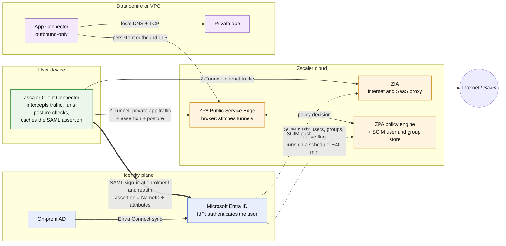
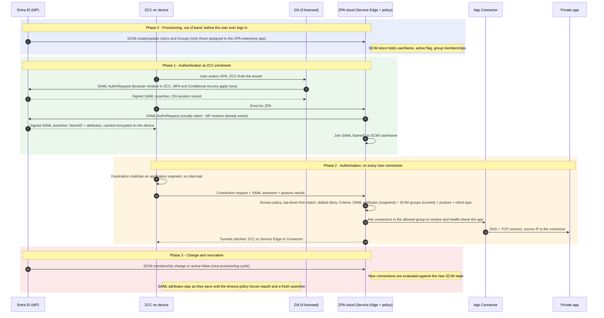

# README

# ZPA identity: IdP, SAML, SCIM, ZCC and ZIA

*Vendor behaviour checked against Zscaler and Microsoft documentation on 13 Nov 2026.*

The model to hold onto is that **the IdP authenticates and ZPA authorises**. ZPA never sees a password. It decides access from identity data that reaches it by two separate routes, and each route has different timing and different ways of failing. The two diagrams below show the architecture (who talks to whom) and the lifecycle (what happens when).

## What each piece does

- **Entra ID (the IdP):** proves who the user is. MFA and Conditional Access happen here, not in Zscaler.
- **SAML:** the *pull* route. When ZCC enrols, and again whenever a reauth is forced, the user signs in to the IdP. The IdP sends back a signed assertion (a token) containing NameID (the username Entra sends) plus any attributes you've configured. ZPA can take a wide range of authorisation attributes from the assertion. ZIA only takes identity, group and department. ZCC keeps the assertion encrypted on the device, and it's checked on every application access attempt. ([Zscaler: About SAML Attributes](https://help.zscaler.com/zpa/about-samlattributes))
- **SCIM:** the *push* route. The IdP creates, updates and disables users and groups in ZPA on its own schedule, with no sign-in involved. This is what lets ZPA quickly remove users who are disabled or deleted in the directory, and lets policy use SCIM attributes and groups. It also means you can write rules against a group before anyone in it has signed in. ([Zscaler: About SCIM](https://help.zscaler.com/zpa/about-scim))
- **ZCC (Zscaler Client Connector):** the agent on the device. It decides whether a destination belongs to an app segment, runs the posture checks, and keeps two separate tunnels open, one to ZIA and one to ZPA.
- **ZIA:** the internet and SaaS proxy. It's not in the path for private-app traffic. Its main overlap with ZPA is the shared ZCC enrolment. On a ZPA-only deployment it drops out entirely.
- **ZPA:** the Public Service Edge evaluates access policy and joins the user's tunnel to the connector's tunnel. App Connectors dial *out* to it, so you don't need inbound firewall rules. ZPA blocks access by default until a policy rule explicitly allows it. ([Zscaler: Configuring Access Policies](https://help.zscaler.com/zpa/about-accesspolicy/new))

## Diagrams

### Architecture: who talks to whom

### Lifecycle: provision, authenticate, authorise, revoke

## SAML attributes vs SCIM groups

| | SAML attributes | SCIM groups |
|---|---|---|
| How they arrive | In the assertion, at sign-in | Pushed by the IdP, separate from any sign-in |
| How fresh | As at the last sign-in; changes only on reauth | As at the last provisioning cycle (Entra runs every ~40 min, and you can't change that) |
| Visible in the ZPA portal | No, they're held on the device | Yes, on the SCIM Users and SCIM Groups pages |
| Custom attributes | Yes | No, ZPA doesn't support custom SCIM attributes |
| Typical failure | Too many groups to fit; stale until reauth | Nested groups don't get through; groups not assigned to the app never sync |

Sources: [Zscaler: About SCIM](https://help.zscaler.com/zpa/about-scim); [Microsoft: Develop and plan provisioning for a SCIM endpoint](https://learn.microsoft.com/entra/identity/app-provisioning/use-scim-to-provision-users-and-groups).

My recommendation is to use SCIM groups as the main "who" condition in access rules, because they're fresher and you can see and audit them in the portal. Use SAML attributes only for things SCIM can't carry. That's a recommendation, not a decision. It goes in `project/decisions/` once the group data supports it.

## Failure modes that matter here (mostly silent)

1. **The identity join.** The SCIM username must match the NameID in the SAML assertion. Say SCIM sends `mail` and SAML sends UPN, and the two differ for some users. Those users' SCIM groups never attach to their session, so they hit default deny and it looks like a policy bug. To test: compare the NameID source with the SCIM userName mapping in the Entra enterprise app, then check a sample of users whose UPN and mail differ. ([Zscaler: About SCIM](https://help.zscaler.com/zpa/about-scim))
2. **Nested groups.** Entra provisioning doesn't go past the first level of nesting. Assigning a group to the app also doesn't bring in the groups nested inside it. In an AD estate built on nested groups, anyone who only gets membership through nesting never reaches ZPA. They're denied, and nothing logs an error. This is probably the biggest risk to a model built on groups. ([Microsoft: Known issues for provisioning](https://learn.microsoft.com/entra/identity/app-provisioning/known-issues#service-issues); [Microsoft: Entra service limits](https://learn.microsoft.com/entra/identity/users/directory-service-limits-restrictions#overview))
3. **Too many groups for SAML.** Entra puts at most 150 groups in a SAML assertion. Above that it leaves the groups claim out entirely, and those users match no group rules at all. Long-serving staff and admins are the people most likely to hit this. You can avoid it by filtering the claim to only the groups assigned to the app. Also, by default Entra sends groups as object IDs (GUIDs) rather than names, which makes the rules hard to read. ([Microsoft: Configure group claims for applications](https://learn.microsoft.com/entra/identity/hybrid/connect/how-to-connect-fed-group-claims))
4. **How long revocation takes.** For SCIM-based rules, the worst case is one provisioning cycle (about 40 minutes). For SAML-based rules, it's the reauth timeout, which could be days. One reauth gives ZPA a new assertion and resets the reauth timer for every application. Whether connections already open are cut when SCIM changes is something to test, not assume. ([Zscaler: About Timeout Policy](https://help.zscaler.com/zpa/about-timeout-policy))
5. **Switch-on order.** When SCIM attributes for policy are first enabled, SCIM rules apply to a user only after that user reauthenticates. Plan for this at cutover, or rules will look broken for a while. ([Zscaler: Enabling SCIM for Identity Management](https://help.zscaler.com/unified/enabling-scim-identity-management))
6. **ZIdentity.** If the tenant is subscribed to ZIdentity for users, the SAML and SCIM criteria are replaced with Session and User Attributes. The IdP is then set up in ZIdentity rather than ZPA. That changes where the config lives, what Terraform targets and which logs Splunk reads. **Assumption to test:** which model your tenant is on. The Zscaler technical staff at your check-in can confirm it. ([Zscaler: Configuring Timeout Policies](https://help.zscaler.com/unified/configuring-timeout-policies))

## What this means for discovery

Every segment rule is "who + context → what". Discovery so far has been about the "what" (hosts and apps). The "who" comes from whatever groups exist in AD and Entra today, and those were probably built for file shares and mailing lists, not app access. Before designing segments, get four numbers:

- groups assigned to the ZPA enterprise app
- how deep the nesting goes
- users in more than 150 groups
- users whose UPN and mail differ

Each one tells you whether a group-based rule will match the people you meant it to.
