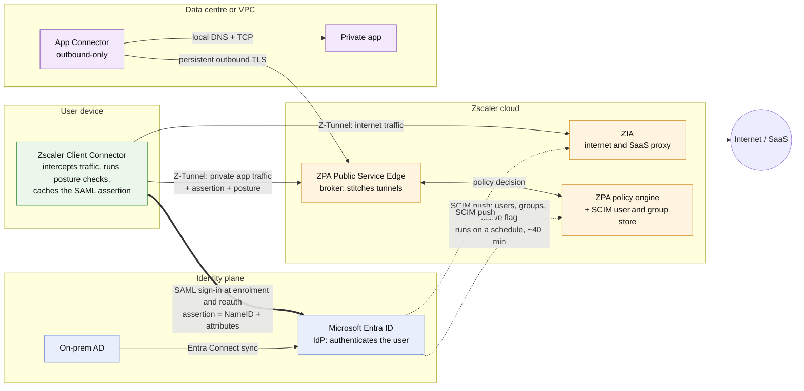
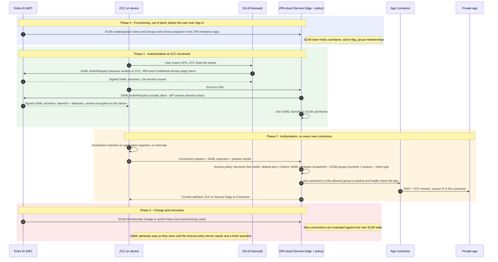
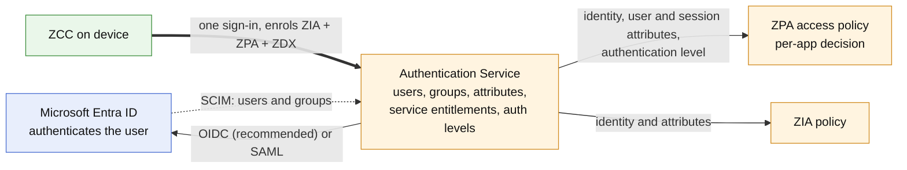

# ZPA identity: IdP, SAML, SCIM, ZCC, ZIA and Authentication Service

*Checked against Zscaler and Microsoft documentation on 13 Nov 2026 (identity flow) and 19 Nov 2026 (Authentication Service and end-user migration).*

## Current state in this tenant

| Item | Status | Basis |
|---|---|---|
| Admins sign in to the Zscaler consoles through Authentication Service (formerly ZIdentity) | **Observed** | Confirmed by the project analyst, 19 Nov 2026 |
| End users still federate directly from Entra to ZPA (and ZIA) using SAML and SCIM | **Assumed** | Follows from admin-only use. Not yet checked |
| Whether Entra connects to Authentication Service over OIDC or SAML | **Unknown** | Matters for step-up authentication (see below) |

**Test for the end-user assumption** (owner: project analyst, about two minutes in the Zscaler Admin Console): ZPA access policy criteria are labelled **SAML and SCIM Attributes** rather than **Session and User Attributes**, and there is no **End User Entitlements** page. If both are true, the legacy-model sections below describe how ZPA authenticates users here today.

## The model

The model to hold onto is that **the IdP authenticates and ZPA authorises**. ZPA never sees a password. It decides access from identity data that reaches it by two separate routes, and each route has different timing and different ways of failing. The diagrams below show the architecture (who talks to whom) and the lifecycle (what happens when).

## What each piece does

- **Entra ID (the IdP):** proves who the user is. MFA and Conditional Access happen here, not in Zscaler.
- **SAML:** the *pull* route. When ZCC enrols, and again whenever a reauth is forced, the user signs in to the IdP. The IdP sends back a signed assertion (a token) containing NameID (the username Entra sends) plus any attributes you've configured. ZPA can take a wide range of authorisation attributes from the assertion. ZIA only takes identity, group and department. ZCC keeps the assertion encrypted on the device, and it's checked on every application access attempt. ([Zscaler: About SAML Attributes](https://help.zscaler.com/zpa/about-samlattributes))
- **SCIM:** the *push* route. The IdP creates, updates and disables users and groups in ZPA on its own schedule, with no sign-in involved. This is what lets ZPA quickly remove users who are disabled or deleted in the directory, and lets policy use SCIM attributes and groups. It also means you can write rules against a group before anyone in it has signed in. ([Zscaler: About SCIM](https://help.zscaler.com/zpa/about-scim))
- **ZCC (Zscaler Client Connector):** the agent on the device. It decides whether a destination belongs to an app segment, runs the posture checks, and keeps two separate tunnels open, one to ZIA and one to ZPA.
- **ZIA:** the internet and SaaS proxy. It's not in the path for private-app traffic. Its main overlap with ZPA is the shared ZCC enrolment. On a ZPA-only deployment it drops out entirely.
- **ZPA:** the Public Service Edge evaluates access policy and joins the user's tunnel to the connector's tunnel. App Connectors dial *out* to it, so you don't need inbound firewall rules. ZPA blocks access by default until a policy rule explicitly allows it. ([Zscaler: Configuring Access Policies](https://help.zscaler.com/zpa/about-accesspolicy/new))
- **Authentication Service (formerly ZIdentity):** Zscaler's own identity service, sitting between the IdP and the Zscaler services. In this tenant it handles admin sign-in only. See [Authentication Service](#authentication-service-formerly-zidentity) below.

## Diagrams

These show the **current (legacy) end-user model**, where Entra connects to ZPA directly. The target model is in [Onboarding end users](#onboarding-end-users-to-authentication-service).

### Architecture: who talks to whom

### Lifecycle: provision, authenticate, authorise, revoke

## SAML attributes vs SCIM groups

This table describes the legacy model. Under Authentication Service, SAML attributes become **session attributes** and SCIM attributes become **user attributes**, both held in Authentication Service, and custom attributes are supported.

| | SAML attributes | SCIM groups |
|---|---|---|
| How they arrive | In the assertion, at sign-in | Pushed by the IdP, separate from any sign-in |
| How fresh | As at the last sign-in; changes only on reauth | As at the last provisioning cycle (Entra runs every ~40 min, and you can't change that) |
| Visible in the ZPA portal | No, they're held on the device | Yes, on the SCIM Users and SCIM Groups pages |
| Custom attributes | Yes | No, ZPA doesn't support custom SCIM attributes |
| Typical failure | Too many groups to fit; stale until reauth | Nested groups don't get through; groups not assigned to the app never sync |

Sources: [Zscaler: About SCIM](https://help.zscaler.com/zpa/about-scim); [Microsoft: Develop and plan provisioning for a SCIM endpoint](https://learn.microsoft.com/entra/identity/app-provisioning/use-scim-to-provision-users-and-groups).

My recommendation is to use SCIM groups as the main "who" condition in access rules, because they're fresher and you can see and audit them in the portal. Use SAML attributes only for things SCIM can't carry. That's a recommendation, not a decision. It goes in `project/decisions/` once the group data supports it.

## Failure modes that matter here (mostly silent)

1. **The identity join.** The SCIM username must match the NameID in the SAML assertion. Say SCIM sends `mail` and SAML sends UPN, and the two differ for some users. Those users' SCIM groups never attach to their session, so they hit default deny and it looks like a policy bug. To test: compare the NameID source with the SCIM userName mapping in the Entra enterprise app, then check a sample of users whose UPN and mail differ. ([Zscaler: About SCIM](https://help.zscaler.com/zpa/about-scim))
2. **Nested groups.** Entra provisioning doesn't go past the first level of nesting. Assigning a group to the app also doesn't bring in the groups nested inside it. In an AD estate built on nested groups, anyone who only gets membership through nesting never reaches ZPA. They're denied, and nothing logs an error. This is probably the biggest risk to a model built on groups. It still applies after a move to Authentication Service, because SCIM still comes from Entra's provisioning service. ([Microsoft: Known issues for provisioning](https://learn.microsoft.com/entra/identity/app-provisioning/known-issues#service-issues); [Microsoft: Entra service limits](https://learn.microsoft.com/entra/identity/users/directory-service-limits-restrictions#overview))
3. **Too many groups for SAML.** Entra puts at most 150 groups in a SAML assertion. Above that it leaves the groups claim out entirely, and those users match no group rules at all. Long-serving staff and admins are the people most likely to hit this. You can avoid it by filtering the claim to only the groups assigned to the app. Also, by default Entra sends groups as object IDs (GUIDs) rather than names, which makes the rules hard to read. If Entra connects over OIDC instead (possible with Authentication Service), the limit is 200. ([Microsoft: Configure group claims for applications](https://learn.microsoft.com/entra/identity/hybrid/connect/how-to-connect-fed-group-claims))
4. **How long revocation takes.** For SCIM-based rules, the worst case is one provisioning cycle (about 40 minutes). For SAML-based rules, it's the reauth timeout, which could be days. One reauth gives ZPA a new assertion and resets the reauth timer for every application. Whether connections already open are cut when SCIM changes is something to test, not assume. ([Zscaler: About Timeout Policy](https://help.zscaler.com/zpa/about-timeout-policy))
5. **Switch-on order.** When SCIM attributes for policy are first enabled, SCIM rules apply to a user only after that user reauthenticates. Plan for this at cutover, or rules will look broken for a while. ([Zscaler: Enabling SCIM for Identity Management](https://help.zscaler.com/unified/enabling-scim-identity-management))
6. **The Authentication Service move.** Admins are on Authentication Service and end users (assumed) are not. Moving end users changes where the IdP, the SCIM feed and the attributes are configured, what the policy criteria are called, and which rules can still be edited. See [Onboarding end users](#onboarding-end-users-to-authentication-service).

## What this means for discovery

Every segment rule is "who + context → what". Discovery so far has been about the "what" (hosts and apps). The "who" comes from whatever groups exist in AD and Entra today, and those were probably built for file shares and mailing lists, not app access. Before designing segments, get four numbers:

- groups assigned to the ZPA enterprise app
- how deep the nesting goes
- users in more than 150 groups
- users whose UPN and mail differ

Each one tells you whether a group-based rule will match the people you meant it to.

## Authentication Service (formerly ZIdentity)

The product has been renamed twice: ZSLogin → ZIdentity → Authentication Service. In the Experience Center console, ZPA appears as "Private Access" or "Private Applications" and ZIA as "Internet & SaaS", so expect all of these names in the documentation.

Authentication Service is Zscaler's common identity service. It sits between your enterprise IdP and the Zscaler services, and it does **not** replace the IdP. Entra still authenticates the user. Authentication Service then holds the user's identity data and passes it to ZIA and ZPA. It supports OIDC and SAML towards the IdP, and Zscaler recommends OIDC. ([Zscaler blog: Zero Trust Administration & Authentication](https://www.zscaler.com/blogs/product-insights/zero-trust-administration-authentication-zscaler); [Zscaler: About External Identity Providers](https://help.zscaler.com/unified/about-external-identity-providers))

For end users, it provides:

- **Sign-in:** one authentication enrols ZCC into ZIA, ZPA and ZDX.
- **User directory:** Entra pushes users and groups into it over SCIM, instead of into each service separately.
- **Attributes:** user attributes and session attributes, including custom ones, that ZPA policy can use. ([Zscaler: About Attributes](https://help.zscaler.com/unified/about-attributes))
- **Service entitlements:** which users and groups may use each Zscaler service, optionally restricted by device group. ([Zscaler: Managing Entitlements](https://help.zscaler.com/unified/managing-entitlements))
- **Authentication levels** for step-up authentication.

### Does it authorise users to apps?

No. It handles the coarse gate (which services a user gets) and supplies the inputs to authorisation. The per-app decision stays in ZPA access policy.

| Decision | Who makes it |
|---|---|
| Is this really the person? | Entra (password, MFA, Conditional Access). Authentication Service passes this on |
| May this user use ZPA at all? | Authentication Service, through service entitlements and device groups |
| May this user reach this app segment? | **ZPA access policy** (default deny) |
| Is the sign-in strong enough for this app? | A ZPA rule names the level; Authentication Service, with Entra, makes the user reach it |
| What identity data does policy see? | Authentication Service supplies it; ZPA evaluates it |

## Onboarding end users to Authentication Service

### What changes

Today, Entra holds a separate SAML connection and SCIM feed for ZPA (and for ZIA). After migration, Entra has one sign-in connection and one SCIM feed, both to Authentication Service, and ZIA and ZPA take identity data from there.

### Benefits

Ranked by relevance to this project, not by how Zscaler presents them.

| Benefit | What it gives | Relevance here |
|---|---|---|
| **Step-up authentication per app segment** | A ZPA access rule can require an authentication level. Users who haven't reached it are prompted to authenticate more strongly. Only available with Authentication Service for users | **High.** It directly answers the stated concern about apps being reachable from home: sensitive segments can demand stronger authentication without raising the bar for everything. Step-up with an external IdP runs over OIDC, so it depends on the Entra connection type (unknown, see Current state) |
| **Custom user and session attributes** | Attributes beyond the fixed SCIM set, usable in ZPA policy | **Medium-high.** Lets "who" criteria use things like employment type or business unit from SCIM (current, auditable) instead of SAML (a snapshot until reauth) |
| **One identity integration instead of one per service** | Entra federates and provisions once. ZIA and ZPA stop holding separate IdP and SCIM configs | **Medium-high.** Removes the chance of ZIA and ZPA drifting apart on username mapping or group scope, and leaves one place to check the identity join (failure mode 1) |
| **Service entitlements and device groups** | An explicit list of who may use ZPA, optionally limited to particular devices | **Medium.** All devices are already managed, so device groups mostly formalise the current state. The entitlement list does give a clean, auditable answer to "who has ZPA" |
| **Adaptive Access Engine** | Risk-based access that reacts to Zscaler and third-party signals. Requires Authentication Service for users and is provisioned per customer on request | **Medium, later phase.** Don't switch it on inside the rollback window (see below) |
| **Single sign-in for users** | One authentication enrols ZCC into every Zscaler service | **Low-medium.** With Entra SSO in place, users probably see one prompt already (inferred) |

**Not a benefit here:** Zscaler lists "enforce MFA at Zscaler" as a migration benefit, but it applies only to users created in Authentication Service itself (hosted users). Users federated from Entra keep MFA in Entra.

No deadline for migrating end users was found in the material reviewed. The admin migration had deadlines; the end-user migration is started on request through Zscaler Support.

### Costs, risks and what changes

1. **A missing entitlement ends sessions.** Every user must be entitled to Private Access in Authentication Service, or their sessions are terminated. Zscaler may not know who was assigned to ZPA historically, because those assignments sit in the Entra enterprise app, and the first entitlement assignment is manual. **Test:** reconcile the Entra ZPA app's assigned users and groups against the Authentication Service entitlement groups before complete migration.
2. **ZIA is in scope too.** The migration audits IdPs, groups and attributes for ZIA as well as ZPA. Every IdP and domain configured in either service, including disabled IdPs, must be set up the same way in Authentication Service. ZIA has been in production since 2020, so its identity setup needs an inventory and its owners need to be involved.
3. **The SCIM feed moves.** After migration, SCIM from Entra to ZPA is blocked and returns errors (for example HTTP 429). Zscaler recommends stopping the Entra ZPA provisioning job before starting. SCIM then goes to Authentication Service. Entra's nesting limits still apply.
4. **Policy changes are frozen at points.** Policy creation, IdP configuration and SCIM sync updates are restricted during complete migration and during any rollback. In the test-user phase, rules referencing Authentication Service can't be created yet.
5. **Rule criteria change.** After migration, new rules can only reference Authentication Service, and the external IdP and its attributes can't be edited. Existing rules keep working through attribute matching: Zscaler says they don't need reconfiguring. Inferred: Terraform-managed ZPA rules will need refactoring for the new IdP and criteria types. Test against one rule first.
6. **Everyone reauthenticates.** After migration, all users and devices are forced to reauthenticate, staggered, after 7 days. The service desk needs a KBA and warning ahead of it.
7. **Rollback is time-boxed and conditional.** It goes through Zscaler Support, only within 14 days. Step-up and Adaptive Access configuration must be deleted first. Policies created after migration aren't rolled back. Re-migrating requires a 24-hour wait.
8. **Logging may change.** Zscaler says labels change on pages including the log receiver and user activity diagnostics after migration. Inferred risk: IdP and attribute fields in LSS logs may change. The help desk triage dashboard (`project/design/help-desk-triage-dashboard.md`) assumes the ZPA `Username` matches the UPN. **Test:** compare test users' log records in Splunk before and after their migration.
9. **Some users are excluded.** Privileged Remote Access (PRA) and emergency access users aren't migrated. Tenants using Private Access Partner Logins can't do test-user migration. The Deception landmine client isn't supported.
10. **ZCC version floor.** Windows and macOS 4.8 or later, Android 4.1 or later, iOS 4.4.4 or later. For Linux, Zscaler's two migration pages disagree (3.7.2 vs 4.2.1), so plan on 4.2.1.
11. **Another component in the sign-in path (inferred).** Authentication Service becomes part of every user sign-in to ZIA and ZPA. Its own session settings also add a timer to revocation: an idle timeout of 5–600 minutes, and an option that decides whether a ZPA reauth goes back to Entra.

### Migration in outline

1. Zscaler Support enables the tenant for end-user migration. Admin migration must be complete first, which it is here.
2. In Authentication Service, set up the same IdPs and domains used by ZIA and ZPA, SCIM from Entra with all users and groups, and every user and session attribute used in policies.
3. The migration wizard audits IdPs, groups and attributes, then the service entitlements.
4. Migrate 1 to 1,000 test users, who must be existing users. Wait 24 hours before the next step. Test users confirm they can reauthenticate to ZPA and get the same policy results as before.
5. Complete the migration. This takes minutes to hours.
6. The rollback window is 14 days.

### Before deciding: what to test

| Assumption or unknown | Owner | Test |
|---|---|---|
| End users are not on Authentication Service | Project analyst | Portal check under Current state |
| Entra connects to Authentication Service over OIDC (needed for step-up) | Identity team | Check the external identity configuration in the Admin Console |
| All IdP configs and domains in ZIA and ZPA, including disabled ones | Zscaler admin | Inventory the IdP configuration pages in both services |
| Who is assigned to ZPA in Entra vs who should be entitled | Identity team | Export the Entra ZPA app's assignments and compare |
| SAML attributes used in ZIA and ZPA policy criteria | Zscaler admin | Export policies and list their criteria |
| ZCC versions across the fleet | Endpoint team | ZCC portal export, or the ZPA User Status log in Splunk |
| PRA, emergency access or partner logins in use | Zscaler admin | Check the portal |
| Entra honours the requested authentication level for step-up (inferred to use Conditional Access authentication contexts) | Identity team, with Zscaler staff | Confirm the mechanism, then test with one user |
| LSS log fields change after migration | Splunk admin | Compare test users' records before and after |
| Terraform impact | Terraform owner | Plan against one migrated rule |

### Decision needed: migration timing vs the segment build

Not yet decided. The micro-segmentation build will create many new access rules.

- **Build first, migrate later:** rules are written against external-IdP criteria. They keep working after migration, but anything new or changed afterwards must use Authentication Service criteria, leaving a mixed rule base. Step-up isn't available for sensitive segments until after migration.
- **Migrate first, then build:** the rules are written once against Authentication Service criteria and can use step-up from the start. The cost is the migration effort, the freeze windows, and a delay to the segment build.

Record the choice in `project/decisions/`.

## Sources

- [Zscaler: Migrating End Users to Authentication Service](https://help.zscaler.com/authentication-service/migrating-end-users-authentication-service)
- [Zscaler: Migrating Private Access End Users to Authentication Service](https://help.zscaler.com/zpa/migrating-private-access-end-users-authentication-service)
- [Zscaler: About External Identity Providers](https://help.zscaler.com/unified/about-external-identity-providers)
- [Zscaler: About Attributes](https://help.zscaler.com/unified/about-attributes)
- [Zscaler: Managing Entitlements](https://help.zscaler.com/unified/managing-entitlements)
- [Zscaler: Configuring Authentication Levels](https://help.zscaler.com/unified/configuring-authentication-levels)
- [Zscaler: ZIdentity release summary 2024 (step-up over OIDC)](https://help.zscaler.com/zidentity/release-upgrade-summary-2024)
- [Zscaler: Configuring the Authentication Session](https://help.zscaler.com/unified/configuring-authentication-session)
- [Zscaler blog: Zero Trust Administration & Authentication](https://www.zscaler.com/blogs/product-insights/zero-trust-administration-authentication-zscaler)
- [Zscaler: About SAML Attributes](https://help.zscaler.com/zpa/about-samlattributes)
- [Zscaler: About SCIM](https://help.zscaler.com/zpa/about-scim)
- [Zscaler: About Timeout Policy](https://help.zscaler.com/zpa/about-timeout-policy)
- [Zscaler: Enabling SCIM for Identity Management](https://help.zscaler.com/unified/enabling-scim-identity-management)
- [Microsoft: Known issues for provisioning](https://learn.microsoft.com/entra/identity/app-provisioning/known-issues#service-issues)
- [Microsoft: Configure group claims for applications](https://learn.microsoft.com/entra/identity/hybrid/connect/how-to-connect-fed-group-claims)
- [Microsoft: Entra service limits](https://learn.microsoft.com/entra/identity/users/directory-service-limits-restrictions#overview)
